# CrazyRaceLife2 (CRL2)

A GTA SA:MP/open.mp freeroam gamemode scripted in the Pawn lang with SQL (SQLite) connector built-in.

Live servers:

[](https://gamemonitoring.net/samp/servers/9019170)

[](https://gamemonitoring.net/samp/servers/18949736)


## Features

+ Admin Zone
    + Game editors (property, race and trucking point editting tools)
    + Admin levels 0 to 5 (+ RCON)
    + Granularity for commands
+ ATM for banking services
    + At least one ATM per city/town/village
+ Combat Missions (experimental)
    + Business robbery with numerous NPC shooters
    + Briefcase picking for money exchange ($50k per a Briefcase) at the mission end
+ Deathmatch Minigame
    + Custom arena in the woods
    + "Legal" player killing, no wanted level added per kill
    + 4-minute long matches, 45-second interval before a match for players to join
+ Localization
    + English + Czech + Bosnian (partly, WIP)
+ NPC drivers
	+ 5x Taxi driver per big city + 5x Taxi driver around whole map (20 in total)
	+ 5x Trucking driver
	+ 2x Race driver
+ Personal cellphone
    + Accessed easily via the `KEY_YES` key (Y usually)
    + Send private messages directly to a player
    + Check bank account balance
    + Call a service (car mechanic, pizza delivery, a taxi ride, ...)
+ Prizes
    + Tiki ($10M) and Pumpkin ($1.5M) pickups
    + Hidden on pick up automatically
+ Quests
    + Onboarding and achievement checklist for new players, with cash rewards
    + Defined in the database, progress saved per player
    + Replaced the former tutorial (`/tut` is now an alias for `/quest`)
+ Racing
    + Custom races all across the map
    + Air, ground and naval
    + Stunts
+ Rampage Missions
	+ 5-minute long clashes with NPCs on the street
+ Real Estate
    + Custom spawn point
    + Custom vehicle attached (including the modifitaions)
    + Custom safehouse
    + Up to 7 properties per player
    + Save custom skins (up to 5 per property)
+ Rob Missions
	+ Robberz team: hold LALT/LSHIFT by a commercial property to rob it for up to 20 seconds
	+ Robberies chain into one mission until 5 minutes pass without one
+ Taxi Missions
    + Ad-hoc NPC spawned for a player
    + Randomized customer locations and targets
    + Increased commissions for the taxi rides with done count
    + Areas of operation: LV, SF, LS, or whole map
+ Tow Missions 
    + Car impound service
    + Bonus for a new vehicle model (per mission)
    + Increased commission for the tow mission count and distance from SF Docks
+ Teams
    + Custom salary per team 
    + Special commands available
    + Custom weapons
    + Team chat using the exclamation mark at the beginning of a message (e.g. `!message`)
+ Trucking Missions
    + 15+ trucking points (petrol stations etc)
    + Custom missions
    + Weighted commission/bonus per done mission/delivery


## Preview

### On Connect (authorized spawn)

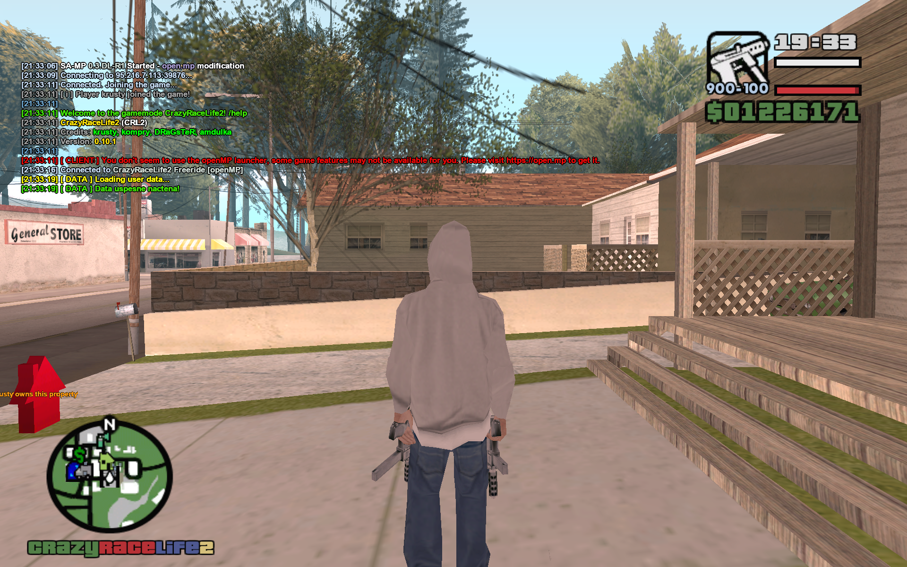

*^ A player spawned at their set spawn-point after a registration/logging-in.*


### Racing

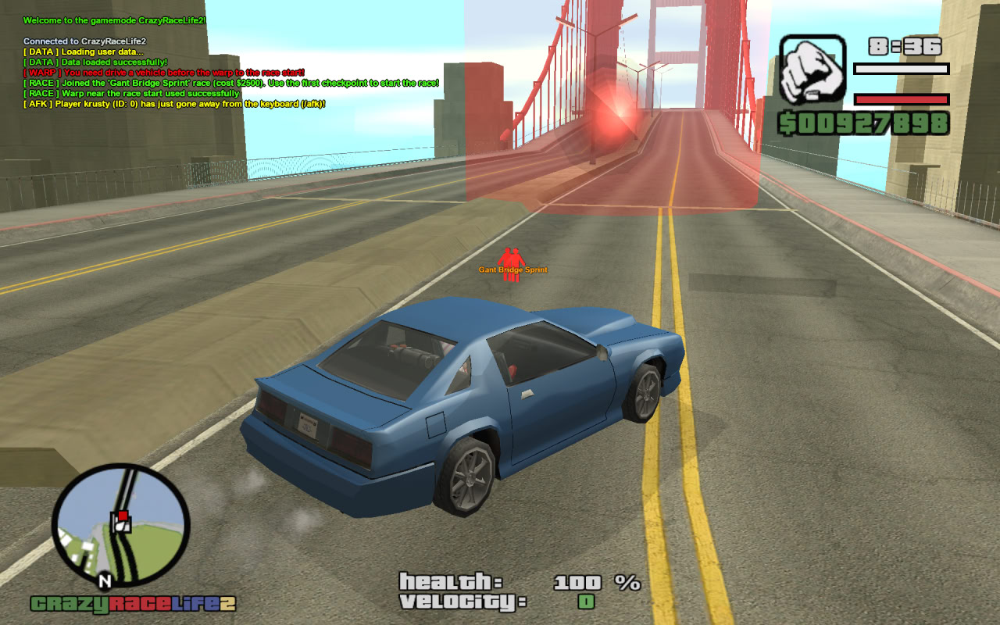

*^ Racing point right after registration into the race. Showing the racing point pickup with the racing point name `3DText` text. The first checkpoint starts the race when entered.*


### Real Estate

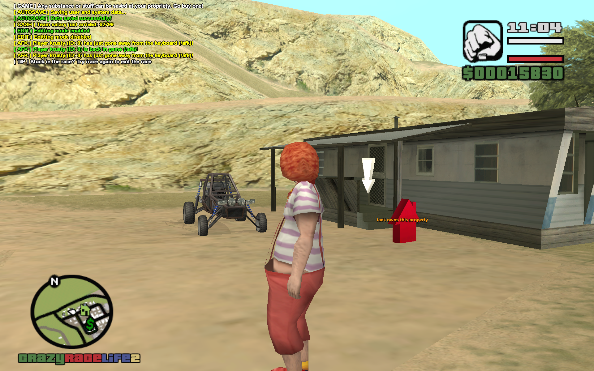

*^ The exterior of every common personal property shows the entrance point (white arrow pickup), the offer point (green/red house pickup according to the occupance state of such property), and custom vehicle attached.*

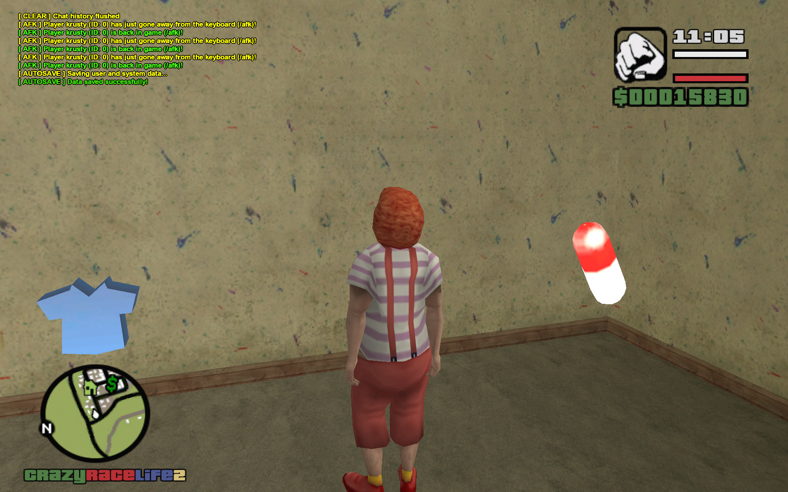

*^ The common interior shows 4 pickups in total: shirt pickup (to change the skin), pills pickup (to deposit/withdraw owned drugz and stuff), heart pickup (to gain full HP and armour), and the exit pickup (to exit the property interior).*

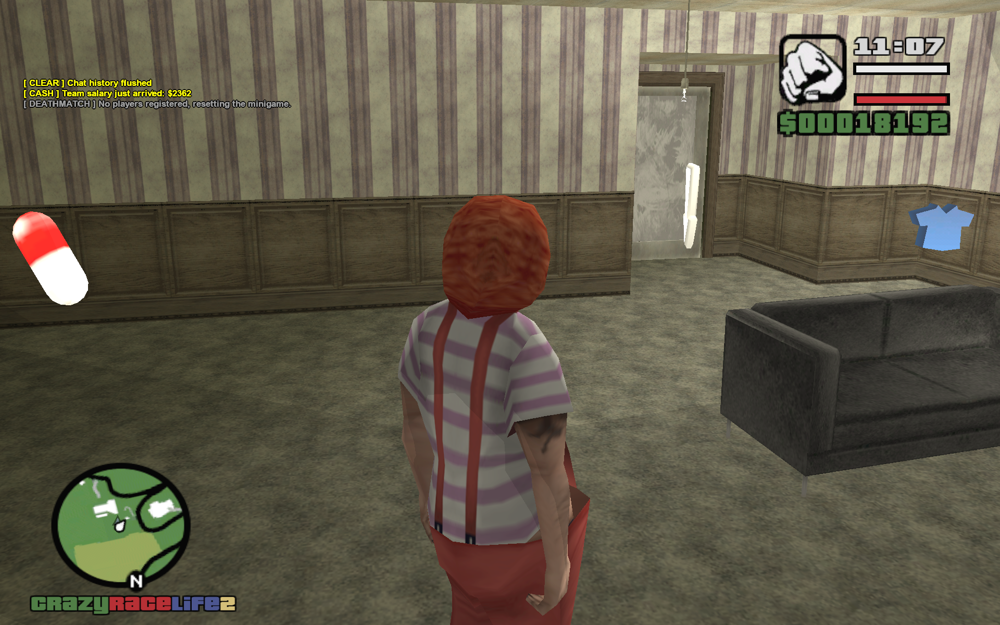

*^ The custom interior is an ad-hoc built interior (very limited occurance). Pickups are places to custom points, allowing the secondary exit(s) as well.*

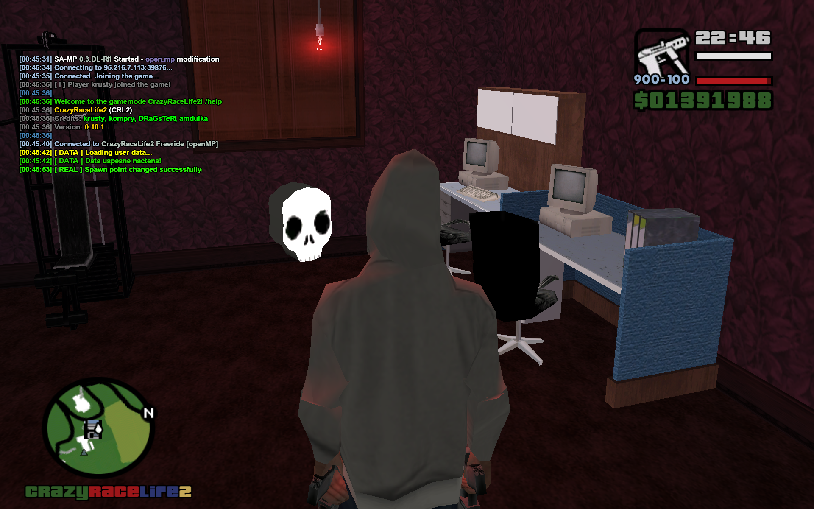

*^ Custom black market entrypoint in a custom interior.*

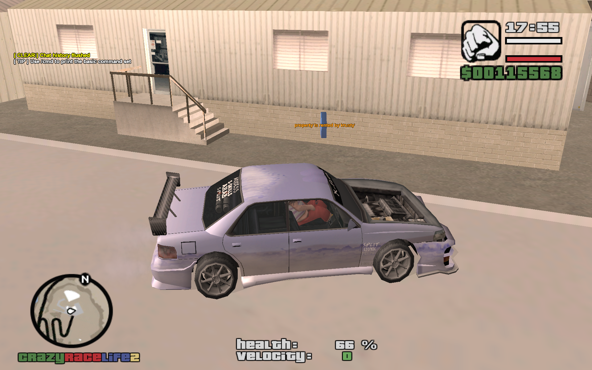

*^ The commercial property exterior example. Occupied state is indicated via the `3DText` text with the tenant's name. This property can still be outbought by another player though.*


### Taxi Missions

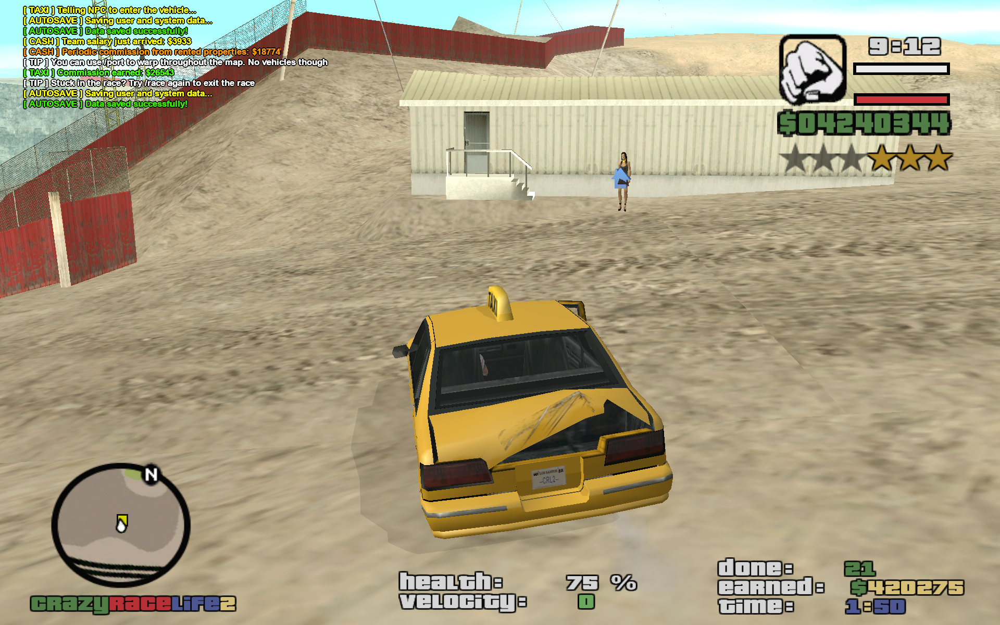

*^ A random customer to take the taxi ride.*

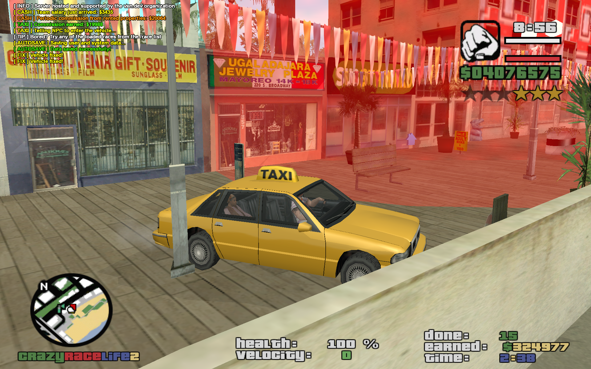

*^ A random target generated by the customer.*

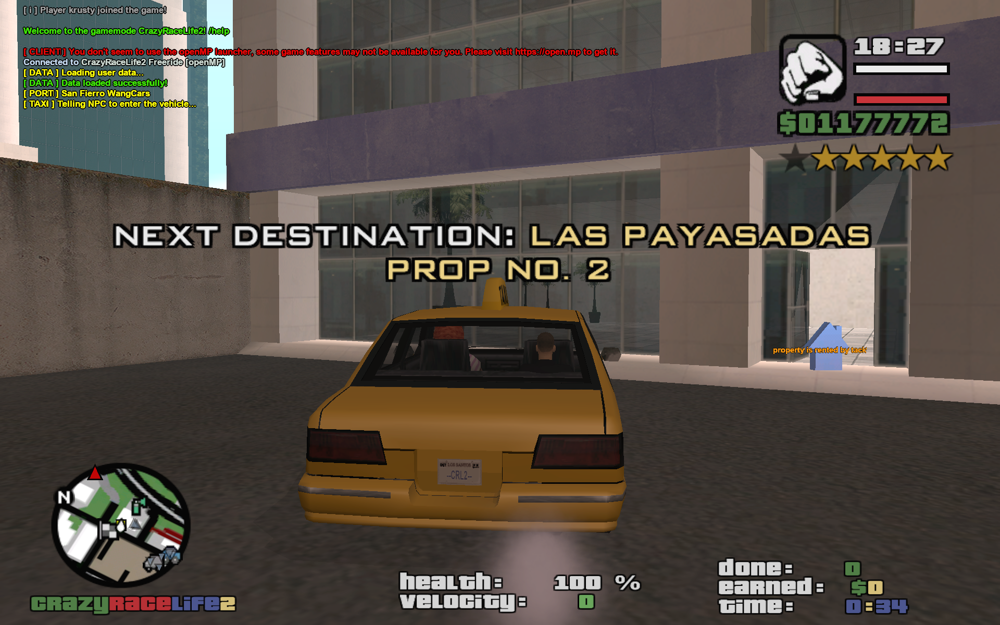

*^ A random destination shown when a new customer enters the taxi cab.*

### Tow Missions

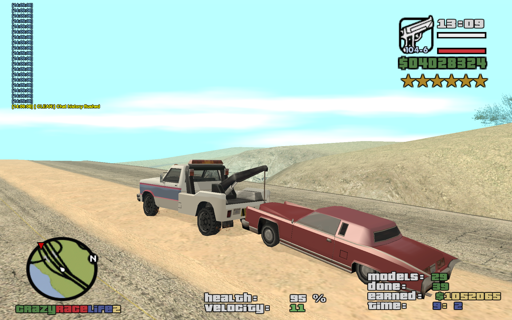

*^ A random tow mission attempt stats while a vehicle being towed.*

### Trucking Missions

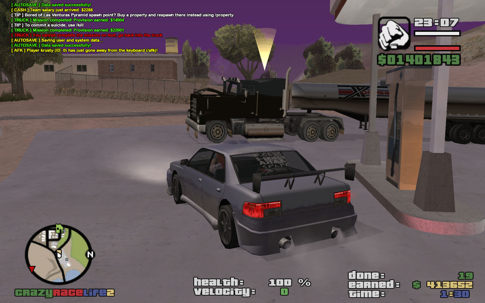

*^ The trucking mission details shown in the right bottom corner. The marked truck in the picture indicates that the mission is "paused" as the player has to drive it to continue the mission.*

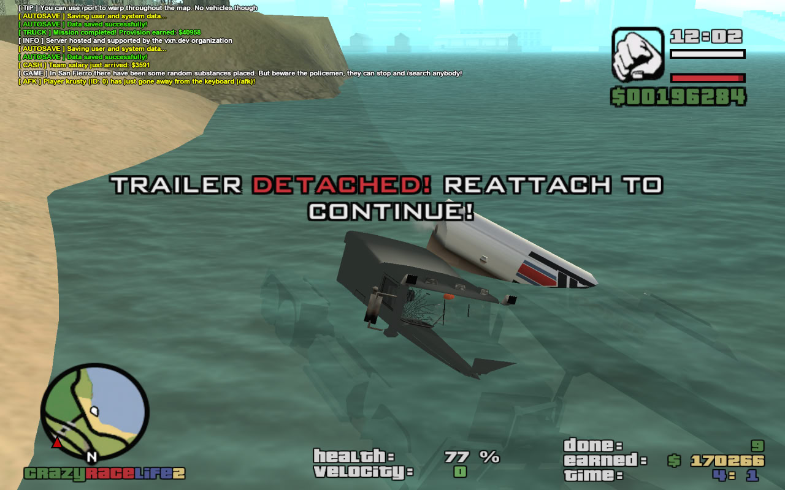

*^ Detail of a detached trailer (decomposing in the sea waters). Custom information text is shown until the trailer is reattached back to the truck registered for the mission.*


### MapUI (legacy)

MapUI is an util to parse and visualize the database data (coords) on the high-res GTA SA map (source: [reddit](https://www.reddit.com/r/sanandreas/comments/9856u1/high_resolution_map_for_grand_theft_auto_san/)): every place the gamemode puts on the map with its details (race routes and best times, owners, team pay, mission records), map-side stats, and — given the live map — every player and NPC as they move. To run it, go to `utils/mapui` and just run it in console like this:

```shell
cd utils/mapui && go run .
```

The MapUI tool is then available at [http://localhost:8082](http://localhost:8082); see [utils/mapui/README.md](utils/mapui/README.md).

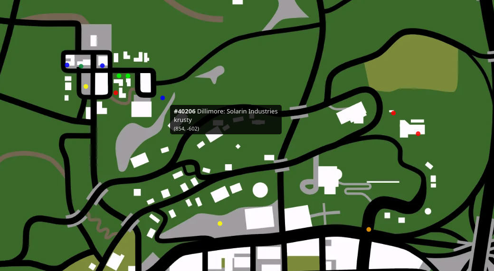

*^ Detailed tooltip for a commercial property in the MapUI util (legacy).*

### Web portal

MapUI also runs as part of a web portal, together with a stats dashboard (statsui: leaderboards, live server info, RCON for admins) and these docs, behind a gateway where players sign in with their game account. `make portal` runs it locally at [http://127.0.0.1:8070](http://127.0.0.1:8070); `compose.portal.yml`, a layer on `compose.yml`, runs it in containers, and `make stack-deploy` runs it as a Docker swarm stack. Its sources, these Make targets and that compose file are kept out of the repository for now (the targets in a gitignored `Makefile.local`, which `Makefile` includes when present). See [docs/portal.md](docs/portal.md).


## How to build

Fetch the `sampctl` tool for the `pawn` package management.

```
dnf install sampctl
```

Clone this repo and try to build it using the `build` command:

```
sampctl ensure
sampctl build

# or Simply
make build
```

The compiled `.amx` gamemode file should then pop up in the `gamemodes` directory.

To build with the debug output on, and to run the test suite (on `./omp-server`, against a database built fresh from the migrations):

```
make build DEBUG=1
make tests
```

See [docs/getting-started.md](docs/getting-started.md) for the details, and for the optional airline filterscript (`make airline`).


## How to run

Simply put the compiled `.amx` gamemode file into the `gamemodes` directory of your SAMP server's. Then update the server config file (`config.cfg`, or `config.json`) like this:

```
gamemode crl2
```

```json
[...]
        "main_scripts": [
            "crl2 1"
        ],
[...]
```

The examples above are shown respectively to the config file names mentioned.


## Vademecum

### Command List

```
    /acc        --- game account info dump
	/admins     --- lists admins online
	/afk        --- (un)sets the Away-From-Keyboard state
    /animoff    --- clears all animations
	/bank       --- lists banking subcommands
	/cmd        --- lists available commands for player
    /credits    --- shows gamemode credits and version
	/dance      --- enables special animations (dancing)
	/deal       --- lists subcommands for dealerz 
	/drug       --- toggles the Drug Mission (Dealerz only)
	/deathmatch --- lists subcommands for the deathmatch module
	/drugz      --- lists substances in pockets
	/dwarp      --- teleports the player in vehicle to racing the common location
	/fix        --- repairs the player's vehicle
	/fork       --- toggles the forklift controls (while driving a forklift)
	/fuel       --- buys a fill-up at the nearest petrol station
	/givecash   --- sends cash to other player
	/hd         --- (un)sets the HUD layout for the HD (widescreen) GTA SA
	/help       --- lists helper information
	/hide       --- (un)hides the player on map
	/kill       --- to commit suicide
	/lay        --- enables special animations (laying)
	/locale     --- shows the language list for localization
	/locate     --- dumps the actual player's coordinates 
	/lock       --- locks the player's vehicle
    /phone      --- shows the phone call menu
	/pm         --- sends the private message to other player
	/port       --- enables to warp to special locations on map
	/prizes     --- dumps the information about Tiki and Pumpkin prizes
	/property   --- lists subcommands for property handling
	/quest      --- lists the quests and your progress
	/race       --- lists subcommands for racing module
	/rules      --- dumps the server rules information
	/scores     --- shows the High Scores table
	/search     --- special command for Policemen
	/skydive    --- enables to skydive from random locations
	/taxi       --- starts a Taxi mission
	/tow        --- starts a Tow mission
	/text       --- sends a public message to other player
	/truck      --- enables/disables the Trucking missions
	/tut        --- same as /quest
	/unlock     --- unlocks the player's vehicle
	/wanted     --- shows the wanted list of online players
```

### Admin Command List

Each level includes the commands of the levels below it. Admins logged in over RCON pass every level check.

#### Level 1
```
	/acmd       --- lists admin commands per level
	/admincol   --- changes the player color according 
	/casino     --- teleports the admin into the casino
	/ccmd       --- prints the /cam usage (unfinished)
	/clear      --- flushes the chat
	/combat     --- lists the combat missions, or aborts the active one
	/flip       --- flips and repairs a player's car
	/hp         --- sets the 100 HP + armour to player
	/nitro      --- sets the nitrous level to player
```

#### Level 2
```
	/cam        --- lists subcommands for camera view
	/countdown  --- sets the seconds to start the countdown
	/get        --- warps the player to admin   
	/goto       --- warps the admin to player
	/skin       --- sets the skin for player
```

#### Level 3
```
	/crime      --- plays the crime sound (Police T-Code), experimental
	/drunk      --- sets the drunk level to a player
	/elevator   --- operates the Admin elevator
	/kick       --- kicks the player from server
	/packet     --- prints the packet loss per player
	/radio      --- toggles the internet radio stream
	/reset      --- resets cash for a player
	/spectate   --- sets the spectate mode on a player
	/vehicle    --- spawns a vehicle by ID
	/weapon     --- sets a vehicle to a player
	/weapons    --- sets the weapons pack to player
```

#### Level 4
```
	/ban        --- bans the player (via IP)
	/edit       --- shows a dialog window with all common editors
	/fakechat   --- sends the fake chat as a player
	/lvl        --- sets the Admin level to player
	/npcrec     --- records an NPC route, or stops the recording
	/restart    --- sets the countdown for 60 seconds to restart the server
```


### Real Estate

Each property ID has to be unique server-wide. It is recommended to use 5-digit format like `40605`, where:

+ `4` stands for the greater zone ID 
+ `06` stands for a district/block ID (incremented)
+ `05` stands for a property ID within the same district/block

Greater zone IDs:

```
1 - San Fierro
2 - Desert
3 - Las Venturas
4 - Countryside, Farms
5 - Los Santos
```


## Development

### omp for Linux

```
-h "95.216.7.113" -p "39876" -n "krusty" -g "C:\\Program Files (x86)\\Rockstar Games\\GTA San Andreas\\"
```

### Manual NPC Connect

```
./samp-npc -h "127.0.0.1" -p "39876" -n "[NPC]taxi" -m "taxi"
```

### Webhook to Telegram

Fetch Go binary from [https://github.com/adnanh/webhook](https://github.com/adnanh/webhook). Then fill Telegram (TG) bot token and chat ID to `configs/webhook.sh` and run it in background using:

```
webhook -hooks configs/webhook.json -verbose &
```
